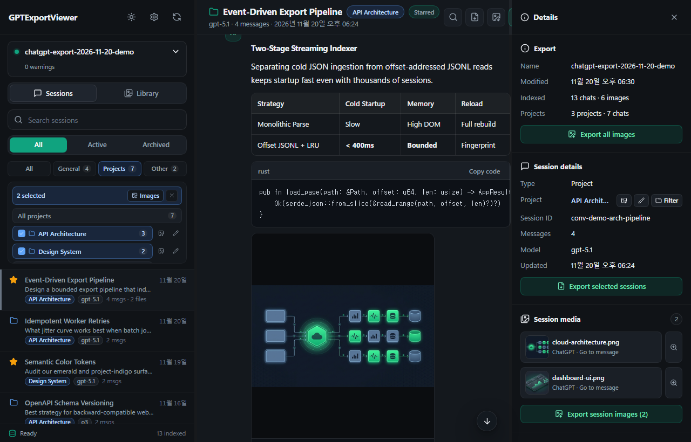
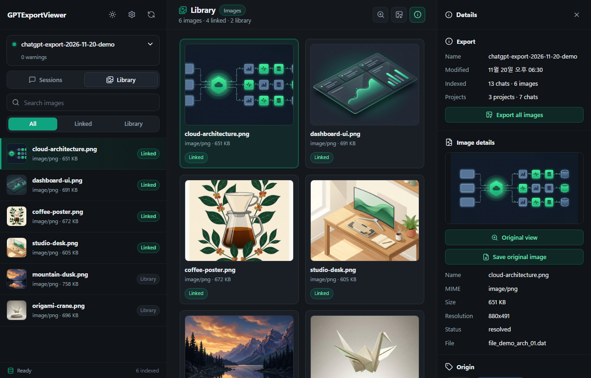
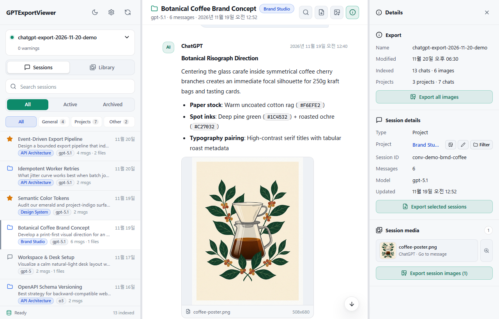

[English](README.md) | **한국어**

# GPTExportViewer

[](https://github.com/Ayumudayo/GPTExportViewer/actions/workflows/ci.yml)
[](https://github.com/Ayumudayo/GPTExportViewer/releases)
[](LICENSE)
[](#실행-요구사항)

GPTExportViewer는 **ChatGPT Export Data**를 로컬에서 빠르고 안전하게 탐색·추출할 수 있는 **Tauri/Rust** 기반 Windows 포터블 데스크톱 뷰어입니다.



## 주요 기능

- **최신·과거 ChatGPT Export 완벽 호환**: 단일 `conversations.json`은 물론 분할 샤딩(`conversations-NNN.json`, `export_manifest.json`), `group_chats.json`, `codex.json`, SVG 이미지, 최신 이미지 생성 첨부 구조를 지원하며 내부 제어 문자(PUA)·인용 태그를 깔끔하게 정리해 표시합니다.
- **대화 유형 분류 및 프로젝트 다중 선택**: **General(일반)**, **Projects(프로젝트)**, **Other(Custom GPT·Group Chat·Codex)** 범위를 구분하며, 프로젝트마다 사용자 지정 별칭을 붙이거나 **여러 프로젝트를 동시에 다중 선택**해 모아볼 수 있습니다.
- **무손실 원본 이미지 일괄 추출**: 재인코딩 없이 원본 `.dat` 자산 그대로 **특정 채팅 1개**, **선택한 여러 채팅**, **선택한 프로젝트(단일/다중)**, **전체 Export** 범위로 추출하며 실시간 진행률과 폴더 바로 열기를 지원합니다.
- **날짜·세션·프로젝트별 계층 폴더 정리**: 원본 이미지 일괄 추출과 세션 원본 JSON 저장 시 단순 평면 나열 대신 `YYYY-MM-DD_<세션제목>`, 프로젝트 별칭 폴더, `General` / `Projects` / `Other` 계층으로 정리합니다.
- **빠른 전체 검색 및 읽기 편의성**: 디스크 기반 JSONL 오프셋 인덱싱, 대화 본문·프로젝트 별칭 통합 검색, 대화 내 `Ctrl+F` 찾기 강조, 스크롤을 조금만 올려도 나타나는 **최하단 바로 이동 버튼**(미로드 페이지 자동 불러오기 지원)을 제공합니다.
- **다크/라이트 테마 및 3단 레이아웃**: 테마 전환과 사이드바·인스펙터 패널 크기 기억 기능을 지원합니다.
- **원본 데이터 읽기 전용 보호**: 원본 ChatGPT Export 폴더 및 자산 파일은 어떤 경우에도 수정하지 않습니다.

## 이미지 라이브러리 & 라이트 모드

<table>
  <tr>
    <td>
      
      <p align="center"><em>연결/라이브러리 전용 구분 배지와 상세 메타데이터를 제공하는 이미지 라이브러리</em></p>
    </td>
    <td>
      
      <p align="center"><em>라이트 테마 대화 뷰어, 인라인 이미지 미리보기 및 최하단 이동 버튼</em></p>
    </td>
  </tr>
</table>

<details>
<summary>모든 예시 화면은 실제 사용자 데이터 없이 100% 가상 데이터로 제작되었습니다</summary>

위 스크린샷은 실제 사용자 대화, 프로젝트, 개인 이미지를 전혀 사용하지 않고, 가상의 데모 데이터와 별도 샘플 일러스트를 실제 앱 UI에 렌더링해 제작했습니다.

</details>

## 다운로드 및 실행 (포터블)

[GitHub Releases](https://github.com/Ayumudayo/GPTExportViewer/releases)에서 설치 없는 포터블 버전을 받을 수 있습니다.

1. **`GPTExportViewer-v1.0.0-windows-x64-portable.zip`** (또는 단일 실행 파일 **`GPTExportViewer-v1.0.0-windows-x64.exe`**)을 다운로드합니다.
2. *(선택)* **`SHA256SUMS.txt`** 로 무결성을 검증할 수 있습니다:
   ```powershell
   Get-FileHash .\GPTExportViewer-v1.0.0-windows-x64-portable.zip -Algorithm SHA256
   ```
3. 압축을 원하는 폴더에 풀고 `GPTExportViewer.exe`를 실행합니다.
4. 첫 실행 화면에서 ChatGPT Export 압축을 풀어 둔 **소스 폴더**를 지정합니다. (상단 `Settings`에서 경로 변경, 새로고침 아이콘으로 새 Export 재스캔 가능)

### 실행 요구사항

- Windows 10 / Windows 11 (x64)
- Microsoft Edge WebView2 Runtime (**110.0.1531.0** 이상 — Windows 11 및 최신 Windows 10 기본 포함)

## 내보내기 폴더 구조

원본 이미지 일괄 추출과 세션 JSON 저장 시 빈 폴더는 만들지 않고 아래처럼 계층화됩니다.

```text
<Export명>-images/                       # 전체 Export 이미지 추출
├── General/
│   └── 2026-11-17_Workspace_Setup/
│       └── studio-desk.png
├── Projects/
│   └── API_Architecture/                # 프로젝트 별칭 우선 사용
│       ├── 2026-11-20_Event-Driven_Export_Pipeline/
│       │   ├── cloud-architecture.png
│       │   └── dashboard-ui.png
│       └── _Project Library/            # 채팅 미연결 프로젝트 파일
├── Other/                               # Custom GPT·Group Chat·Codex
└── _Library/                            # 어느 채팅에도 속하지 않은 이미지

%LOCALAPPDATA%\GPTExportViewer\Saved Sessions\<export-id>\
├── General\*.json
├── Projects\<프로젝트별칭>\*.json
└── Other\*.json
```

## 데이터 저장 및 개인정보 보호

- 모든 인덱싱, 검색, 이미지 열람과 추출은 100% 오프라인 로컬에서 동작하며 외부 전송이 없습니다.
- 앱 설정, 검색 인덱스, 썸네일 캐시는 Windows user app data 폴더 아래에 저장됩니다:
  ```text
  %LOCALAPPDATA%\GPTExportViewer
  ```
- 저장한 세션 JSON 파일은 `%LOCALAPPDATA%\GPTExportViewer\Saved Sessions`에 보관됩니다.

## 소스에서 빌드하기

### 개발 요구사항

- Windows 10 / 11 + WebView2 Runtime (`110.0.1531.0` 이상)
- Node.js (v20 또는 v22 LTS) 및 npm
- Rust 및 Cargo (stable)
- Windows MSVC Build Tools

### 명령어

```powershell
npm install
npm test
cargo test --manifest-path src-tauri/Cargo.toml
npm run desktop:dev
npm run desktop:build
```

빌드된 포터블 실행 파일:

```text
src-tauri/target/release/GPTExportViewer.exe
```

## 라이선스

이 프로젝트는 **GNU General Public License v3.0 (GPL-3.0)** 라이선스를 따릅니다. 자세한 내용은 [LICENSE](LICENSE)를 확인하세요.
