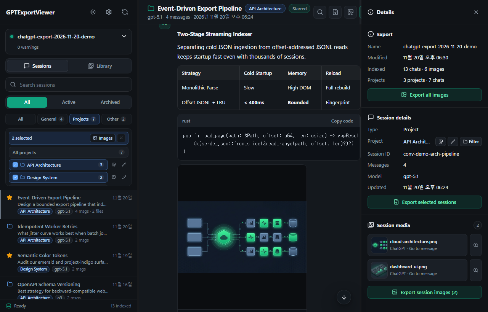
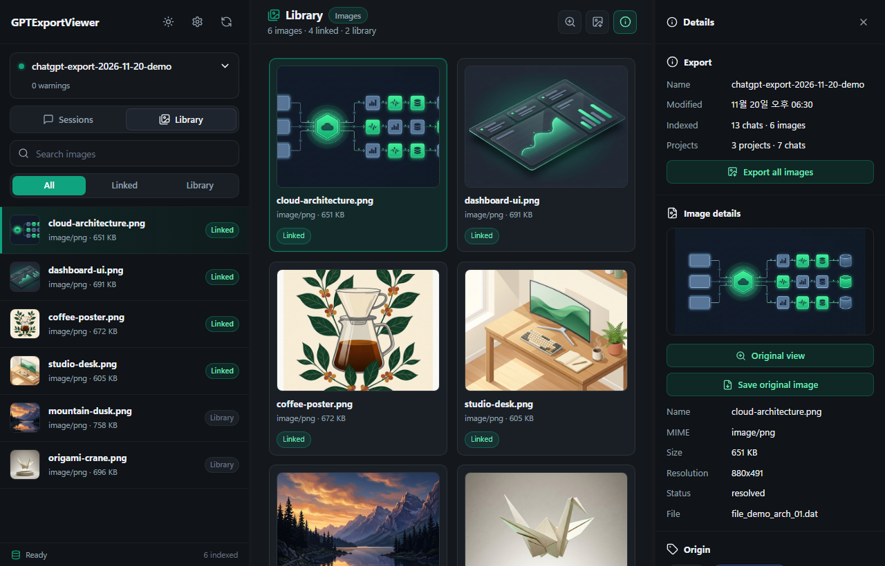
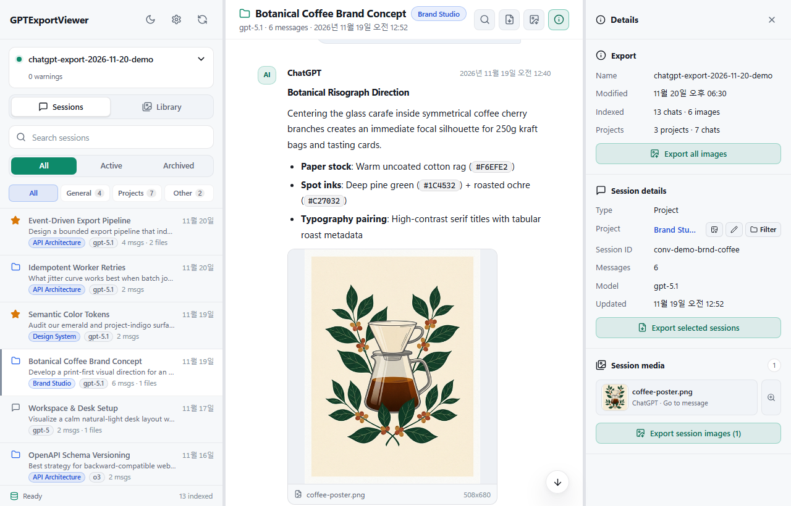

**English** | [한국어](README.ko.md)

# GPTExportViewer

[](https://github.com/Ayumudayo/GPTExportViewer/actions/workflows/ci.yml)
[](https://github.com/Ayumudayo/GPTExportViewer/releases)
[](LICENSE)
[](#requirements)

GPTExportViewer is a fast, local, read-only Windows desktop viewer and asset extractor for **ChatGPT Export Data**, built on **Tauri/Rust** and React.



## Features

- **Modern & Legacy ChatGPT Exports**: Supports single `conversations.json` files as well as sharded `conversations-NNN.json` exports (`export_manifest.json`), `group_chats.json`, `codex.json`, SVG assets, and modern image generation attachments while stripping internal PUA/annotation markers cleanly.
- **Structured Conversation Scopes & Multi-Select Projects**: Separates **General**, **Projects**, and **Other** (Custom GPTs, Group Chats, Codex). Assign custom persistent names to projects, toggle **multiple projects simultaneously**, and filter across your selection.
- **Lossless Original Image Extraction**: Export original full-resolution image files without re-encoding for **one session**, **multiple selected sessions**, **selected project(s)**, or the **entire export** with live progress and direct folder opening.
- **Hierarchical Organized Folders**: Both batch **original image exports** and **saved session JSON files** are automatically arranged into date-prefixed (`YYYY-MM-DD_<Title>`) and category/project folders so large archives stay structured instead of dumping everything flat.
- **Fast Search & Reading Ergonomics**: Disk-backed JSONL offset indexing, full-text + project-alias search, in-conversation `Ctrl+F` highlighting, and a floating **Scroll to Bottom** button (which also loads remaining paginated turns automatically).
- **Light & Dark Themes**: Toggle between polished dark and light palettes with resizable 3-pane desktop layout persistence.
- **Strictly Read-Only Source Handling**: Original export folders and `.dat` asset files are never modified.

## Gallery & Light Mode

<table>
  <tr>
    <td>
      
      <p align="center"><em>Image Library gallery with linked/library-only badges &amp; metadata inspector</em></p>
    </td>
    <td>
      
      <p align="center"><em>Light theme reader with botanical asset preview &amp; Scroll-to-Bottom button</em></p>
    </td>
  </tr>
</table>

<details>
<summary>All screenshots use 100% synthetic demo data — no personal exports</summary>

The showcase screenshots above are rendered directly in the app UI using a fictional demo dataset and custom sample illustrations. No personal ChatGPT conversations, projects, or user images are included.

</details>

## Download & Portable Usage (Windows)

Portable builds are published on [GitHub Releases](https://github.com/Ayumudayo/GPTExportViewer/releases):

1. Download **`GPTExportViewer-v1.0.0-windows-x64-portable.zip`** (or standalone **`GPTExportViewer-v1.0.0-windows-x64.exe`**).
2. *(Optional)* Verify file integrity against **`SHA256SUMS.txt`**:
   ```powershell
   Get-FileHash .\GPTExportViewer-v1.0.0-windows-x64-portable.zip -Algorithm SHA256
   ```
3. Unzip anywhere and run `GPTExportViewer.exe`. No installer or administrator rights required.
4. Select the folder containing your extracted ChatGPT export folder(s) during onboarding (you can switch or rescan later from **Settings**).

### Requirements

- Windows 10 / Windows 11 (x64)
- Microsoft Edge WebView2 Runtime (**110.0.1531.0** or later — preinstalled on Windows 11 and modern Windows 10)

## Exported Folder Organization

When batch-exporting **original images** or saving **original session JSON** files, GPTExportViewer organizes output into structured folders (empty folders are never created):

```text
<ExportName>-images/                     # Full export images
├── General/
│   └── 2026-11-17_Workspace_Setup/
│       └── studio-desk.png
├── Projects/
│   └── API_Architecture/                # Uses your custom project alias if set
│       ├── 2026-11-20_Event-Driven_Export_Pipeline/
│       │   ├── cloud-architecture.png
│       │   └── dashboard-ui.png
│       └── _Project Library/            # Unlinked project-owned assets
├── Other/                               # Custom GPTs, Group Chats, Codex
└── _Library/                            # Unlinked library-only assets

%LOCALAPPDATA%\GPTExportViewer\Saved Sessions\<export-id>\
├── General\*.json
├── Projects\<ProjectAlias>\*.json
└── Other\*.json
```

## Data & Privacy

- All indexing and viewing happen 100% offline on your machine; no telemetry or network upload occurs.
- Application settings, search indexes, and thumbnail caches are stored inside Windows user app data:
  ```text
  %LOCALAPPDATA%\GPTExportViewer
  ```
- Exported sessions are saved under `%LOCALAPPDATA%\GPTExportViewer\Saved Sessions`.

## Building from Source

### Prerequisites

- Windows 10 / 11 + WebView2 Runtime (`110.0.1531.0`+)
- Node.js (v20 or v22 LTS) & npm
- Rust & Cargo (stable)
- Visual Studio C++ Build Tools (MSVC)

### Commands

```powershell
npm install
npm test
cargo test --manifest-path src-tauri/Cargo.toml
npm run desktop:dev
npm run desktop:build
```

Portable executable output:

```text
src-tauri/target/release/GPTExportViewer.exe
```

## License

This project is licensed under the **GNU General Public License v3.0 (GPL-3.0)** — see [LICENSE](LICENSE) for full terms.
